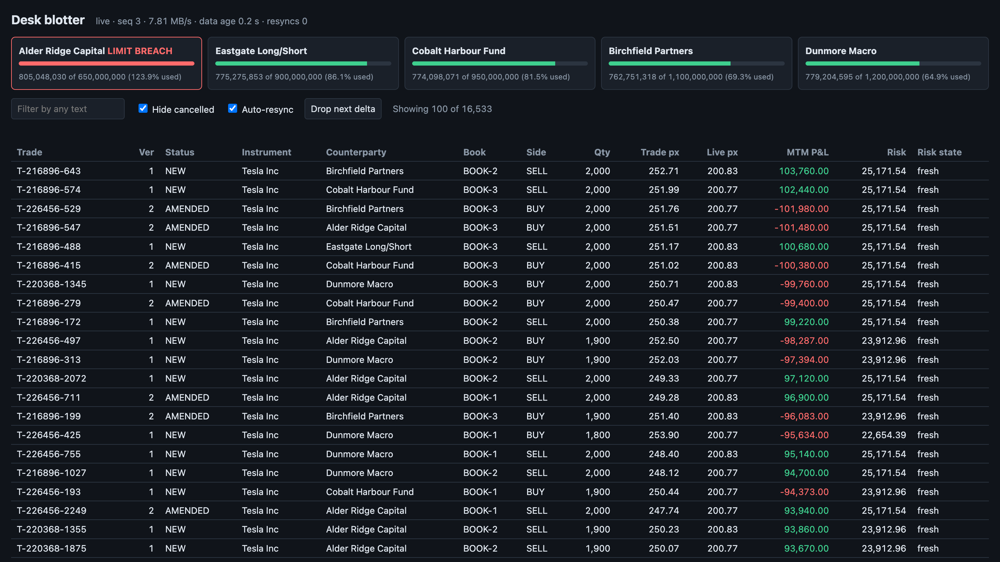
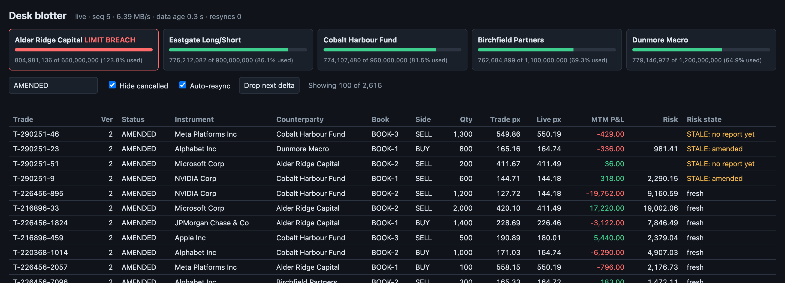
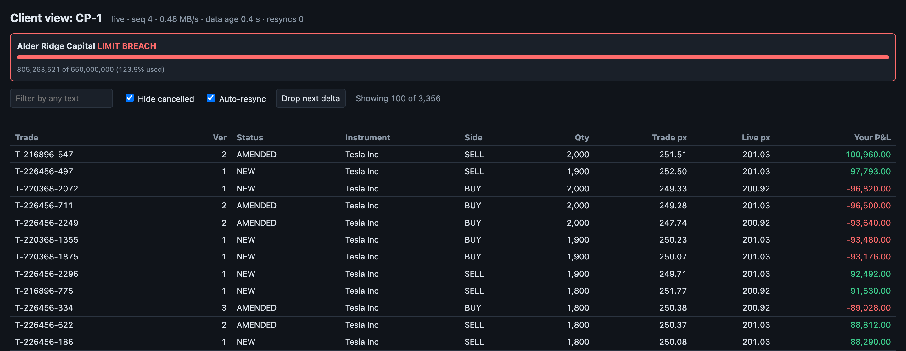
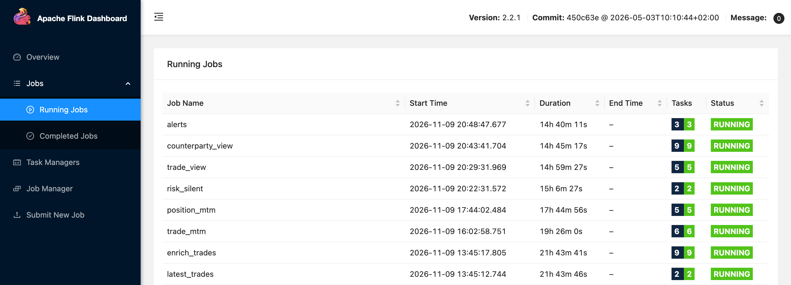
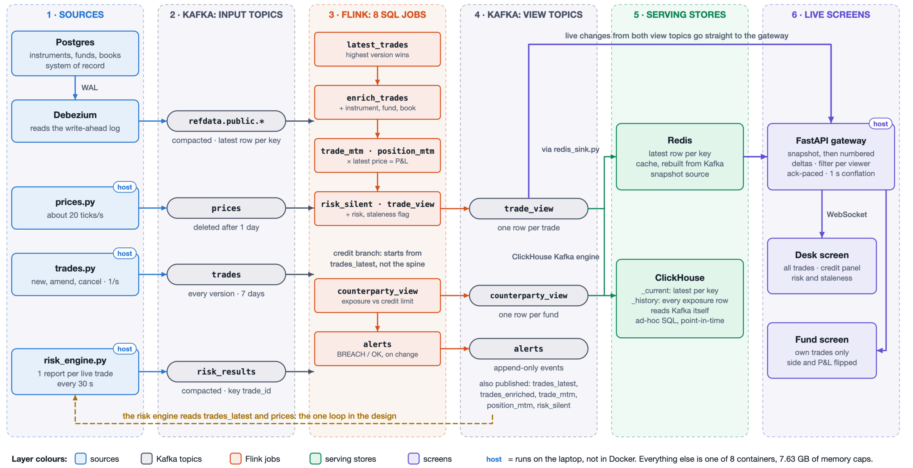

# Real-time trade & risk dashboard

A streaming platform for a bank trading desk's front office: live P&L on every trade, a risk number with a flag that says when it can't be trusted, and each hedge fund's credit exposure checked against its limit, all reaching a browser within seconds of the event. It's built from Kafka, Debezium, Flink SQL, ClickHouse, Redis and a FastAPI WebSocket gateway, and runs entirely on one laptop with Docker Compose in under 8 GB of memory.

https://github.com/user-attachments/assets/1edc2c9a-8716-480d-9805-2744ed74c33a

*The full demo (1:39): the running stack, the live blotter, a deliberately dropped update being repaired, stale risk on amended trades, and a credit limit cut in Postgres that reaches the screen about 2 seconds later as one alert.*

## What it does

The business is a deliberately small one: a desk trading 10 stocks with 5 hedge funds across 3 books. Trades can be amended or cancelled, prices tick about 20 times a second, and a separate risk engine reports on every trade every 30 seconds.

- **Live trade blotter.** Every trade with instrument and fund names, the live price, mark-to-market P&L, and the latest risk number.
- **Risk you can trust, or a flag saying you can't.** Each risk report is stamped with the trade version it was computed on. A trade amended after its report shows `STALE: amended`, and a trade whose reports stop arriving shows `STALE: reports stopped`.
- **Credit limits.** Each fund's exposure against its limit, updated on every tick. A breach must last a full 5-second window before it alerts, and only a change of state publishes an alert.
- **Two views of the same data.** The desk sees everything. A fund's login sees only its own trades, with side and P&L flipped to its point of view, filtered on the server.
- **Updates you can't silently miss.** Every update to a screen is numbered. A gap triggers a fresh snapshot, so a lost message can't leave a wrong number on screen.

The numbers are simplified on purpose: risk is a toy one-day VaR per trade, and exposure is gross with no netting. Real VaR is portfolio-level and not additive.

### Screens

**Desk blotter and credit panel.** One fund is over its limit and four are inside theirs:



**Risk staleness on amended trades.** Some reports were computed on an older version, and some trades have no report yet:



**A hedge fund's own view.** Only its trades, with P&L from its side:



**Eight Flink SQL jobs running continuously:**



## Architecture



Data passes through Kafka twice: once as raw facts (trades, prices, risk reports and reference data captured from Postgres), and once as finished views with one current row per trade or per fund. Flink SQL turns the first into the second. Redis holds the latest snapshot for new screens, ClickHouse holds history for ad-hoc and point-in-time queries, and the gateway sends each browser a snapshot followed by numbered changes.

### Design choices worth a look

| Choice | Why |
|---|---|
| Kafka is the only source of truth for moving data | Redis and ClickHouse can be rebuilt from the topics at any time. Redis rebuilds about 13,800 trades in around 10 seconds. |
| The highest trade version wins, not the latest arrival | Late or duplicated amendments can't bring back an old version of a trade. |
| Trust is a data field | Risk reports carry `trade_version` and `as_of`, so staleness is decided on the row itself. A processing-time session window catches reports that have stopped arriving. |
| Shrink the data before it multiplies | One price tick revalues every trade in that stock. Updates are collapsed once a second, and exposure is totalled per fund and stock before it meets a price. |
| Snapshot plus numbered deltas | A client registers for changes before reading its snapshot, so nothing falls in between. Each client's updates are collapsed separately and paced by its acknowledgements, so a slow browser can't hold up the others. |
| Alerts are edge-triggered | An append-only topic records `BREACH` and `OK` once per real change. A brief spike doesn't fire an alert. |

### Stack

| Layer | Technology |
|---|---|
| Reference data and change capture | Postgres 17, Debezium 3.6 |
| Event log | Apache Kafka 4.3 (KRaft), compacted and append-only topics |
| Stream processing | Apache Flink 2.2, SQL only, 8 jobs with checkpoints |
| Serving | ClickHouse 26.8 (Kafka engine, `ReplacingMergeTree`), Redis 8.2 |
| Gateway and screens | Python, FastAPI, WebSockets, plain HTML and JavaScript |
| Simulators | Python with `confluent-kafka` |

## Running it

The `kafka` profile runs Kafka and Kafka UI. The `cdc` profile adds Postgres and Debezium. The `flink` profile adds a Flink cluster to Kafka and Kafka UI (see [Stream processing](#stream-processing)):

```bash
docker compose --profile cdc up -d
scripts/k kafka-topics --list
```

Kafka UI is at http://localhost:8080.

Create the topics once (topic auto-creation is off):

```bash
scripts/k kafka-topics --create --topic trades --partitions 3 --replication-factor 1 \
  --config cleanup.policy=delete --config retention.ms=604800000
scripts/k kafka-topics --create --topic prices --partitions 3 --replication-factor 1 \
  --config cleanup.policy=delete --config retention.ms=86400000
```

Run the simulators, each in its own terminal, with prices first:

```bash
python3 -m venv .venv
.venv/bin/pip install -r simulators/requirements.txt
.venv/bin/python simulators/prices.py
.venv/bin/python simulators/trades.py
```

### Reference data

Create the compacted topics once, then register the connector. It takes a snapshot of the tables and then follows every change:

```bash
for t in instruments counterparties books; do
  scripts/k kafka-topics --create --topic refdata.public.$t \
    --partitions 1 --replication-factor 1 \
    --config cleanup.policy=compact \
    --config segment.ms=60000 \
    --config min.cleanable.dirty.ratio=0.01
done

curl -s -X POST -H 'Content-Type: application/json' \
  localhost:8083/connectors -d @debezium/refdata-connector.json
curl -s localhost:8083/connectors/refdata/status
```

To view a topic's change events, one per line:

```bash
.venv/bin/python scripts/cdc_tail.py counterparties
```

### Stream processing

Start everything, then open the Flink SQL client, which runs one statement at a time:

```bash
docker compose --profile cdc --profile flink up -d --build
curl -s localhost:8081/overview
docker exec -it jobmanager ./bin/sql-client.sh
```

The Flink UI is at http://localhost:8081.

The saved job in `flink/sql/latest_trades.sql` publishes one current row per trade. Create its output topic once, then submit the job. Submit it again after restarting the stack:

```bash
scripts/k kafka-topics --create --topic trades_latest --partitions 3 --replication-factor 1 \
  --config cleanup.policy=compact --config segment.ms=60000 --config min.cleanable.dirty.ratio=0.01
docker exec jobmanager ./bin/sql-client.sh -f /opt/flink/sql/latest_trades.sql 2>&1 | grep -E 'Job ID|ERROR'
```

To test late and duplicate messages, run `.venv/bin/python simulators/break_versions.py`.

The saved job in `flink/sql/enrich_trades.sql` adds instrument, counterparty and book details to each trade. Create its output topic once, then submit it after `latest_trades.sql`:

```bash
scripts/k kafka-topics --create --topic trades_enriched --partitions 3 --replication-factor 1 \
  --config cleanup.policy=compact --config segment.ms=60000 --config min.cleanable.dirty.ratio=0.01
docker exec jobmanager ./bin/sql-client.sh -f /opt/flink/sql/enrich_trades.sql 2>&1 | grep -E 'Job ID|ERROR'
```

To compare a regular join with a temporal join, submit `flink/sql/join_compare.sql`, follow `docker logs -f --tail 0 taskmanager`, and send trades with `.venv/bin/python simulators/test_trade.py` while changing a row in `counterparties`. It needs a free task slot.

The saved job in `flink/sql/candles.sql` builds 1-minute open/high/low/close candles per instrument. Create its output topic once, then submit the job:

```bash
scripts/k kafka-topics --create --topic candles_1m --partitions 3 --replication-factor 1 \
  --config cleanup.policy=compact --config segment.ms=60000 --config min.cleanable.dirty.ratio=0.01
docker exec jobmanager ./bin/sql-client.sh -f /opt/flink/sql/candles.sql 2>&1 | grep -E 'Job ID|ERROR'
```

To test late data and a silent partition, create a `prices_test` topic with 3 partitions, start a windowed query that reads it from `latest-offset`, then run `.venv/bin/python simulators/break_time.py late` or `silent`.

The saved jobs in `flink/sql/trade_mtm.sql` and `flink/sql/position_mtm.sql` value each trade and each position at the latest price, updating about once a second. Create their output topics once, then submit each job:

```bash
for t in trade_mtm position_mtm; do
  scripts/k kafka-topics --create --topic $t --partitions 3 --replication-factor 1 \
    --config cleanup.policy=compact --config segment.ms=60000 --config min.cleanable.dirty.ratio=0.01
done
docker exec jobmanager ./bin/sql-client.sh -f /opt/flink/sql/trade_mtm.sql 2>&1 | grep -A2 -E 'Job ID|ERROR'
docker exec jobmanager ./bin/sql-client.sh -f /opt/flink/sql/position_mtm.sql 2>&1 | grep -A2 -E 'Job ID|ERROR'
```

`simulators/risk_engine.py` reports risk for every live trade every 30 seconds, and `flink/sql/trade_view.sql` attaches the latest report to each trade with a staleness flag. Create the two topics once, start the engine, then submit the job:

```bash
for t in risk_results trade_view; do
  scripts/k kafka-topics --create --topic $t --partitions 3 --replication-factor 1 \
    --config cleanup.policy=compact --config segment.ms=60000 --config min.cleanable.dirty.ratio=0.01
done
.venv/bin/python simulators/risk_engine.py
docker exec jobmanager ./bin/sql-client.sh -f /opt/flink/sql/trade_view.sql 2>&1 | grep -A2 -E 'Job ID|ERROR'
```

Run `.venv/bin/python scripts/stale_check.py` to see how many trades have stale risk and how old the latest reports are.

`flink/sql/risk_silent.sql` marks a trade when no risk report has arrived for 2 minutes, and `trade_view` shows that as stale. `flink/sql/counterparty_view.sql` compares each counterparty's exposure with its credit limit, and `flink/sql/alerts.sql` publishes one message when a counterparty goes over its limit and one when it comes back. Create the topics once, then submit the jobs:

```bash
for t in risk_silent counterparty_view; do
  scripts/k kafka-topics --create --topic $t --partitions 3 --replication-factor 1 \
    --config cleanup.policy=compact --config segment.ms=60000 --config min.cleanable.dirty.ratio=0.01
done
scripts/k kafka-topics --create --topic alerts --partitions 3 --replication-factor 1 \
  --config cleanup.policy=delete --config retention.ms=604800000
for j in risk_silent counterparty_view alerts; do
  docker exec jobmanager ./bin/sql-client.sh -f /opt/flink/sql/$j.sql 2>&1 | grep -A2 -E 'Job ID|ERROR'
done
```

Run `.venv/bin/python scripts/exposure_check.py` to see exposure against limits, and `scripts/k kafka-console-consumer --topic alerts` to follow alerts.

Each saved job uses one of the eight task slots. `flink/sql/fanout_demo.sql` measures the output of an unconflated price join, and `.venv/bin/python scripts/topic_rate.py <topic>` measures a topic's message rate.

### Serving

The `serving` profile runs ClickHouse (query page at http://localhost:8123/play, user `app`, password `app`) and Redis. If Flink jobs are running, start only these two so they aren't disturbed:

```bash
docker compose --profile cdc --profile flink --profile serving up -d --no-deps clickhouse redis
```

Create the ClickHouse tables once. They read `counterparty_view` and `trade_view` directly, so they need no Flink job:

```bash
docker exec -i clickhouse clickhouse-client -u app --password app --multiquery < clickhouse/counterparty.sql
docker exec -i clickhouse clickhouse-client -u app --password app --multiquery < clickhouse/trades.sql
```

Always use `FINAL` on the `_current` tables, or rows waiting to be merged are counted more than once:

```bash
docker exec clickhouse clickhouse-client -u app --password app -q "SELECT book_id, sum(mtm) FROM serving.trade_current FINAL GROUP BY book_id ORDER BY book_id"
```

`clickhouse/break_final.sql` demonstrates what goes wrong without `FINAL` or a version column.

Start the Redis worker. It rebuilds Redis from Kafka every time it starts, and holds one hash per view topic:

```bash
.venv/bin/pip install -r gateway/requirements.txt
.venv/bin/python gateway/redis_sink.py
docker exec redis redis-cli hget counterparty_view CP-1
```

### Live screens

`gateway/app.py` needs `gateway/redis_sink.py` and the Flink jobs running. It sends each browser a snapshot from Redis, then numbered changes from Kafka once a second:

```bash
.venv/bin/python gateway/app.py
```

| Screen | Address |
|---|---|
| Desk blotter and counterparty panel | http://localhost:8000/?token=desk |
| One fund's own trades, from its side | http://localhost:8000/?token=fund-cp1 (`cp1` to `cp5`) |

`CONFLATE_SECONDS=5 .venv/bin/python gateway/app.py` sends less often. `WS_COMPRESSION=1` turns on WebSocket compression. The tokens are a stand-in for a real login.

To test the protocol without a browser, and compare the result with a fresh snapshot:

```bash
.venv/bin/python scripts/ws_check.py --seconds 30
.venv/bin/python scripts/ws_check.py --drop-after 5 --drops 1
.venv/bin/python scripts/ws_check.py --read-delay 4 --seconds 40
```

The first is a normal client, the second loses a frame and resyncs, and the third acts like a slow client. The "Drop next delta" button on the page does the same as the second.

## Repo layout

| Path | What goes there | Sprint |
|---|---|---|
| `simulators/` | Python producers: prices, trades, risk engine | 2, 9 |
| `postgres/` | Reference data schema and seed | 3 |
| `debezium/` | CDC connector config | 3 |
| `flink/` | Flink SQL and PyFlink jobs | 4–9 |
| `clickhouse/` | Serving tables and views | 10 |
| `gateway/` | Redis worker and FastAPI WebSocket gateway | 10, 11 |
| `ui/` | HTML/JS grid | 11 |
| `spark/` | Spark comparison and Iceberg sink | 12 |
| `scripts/` | Reconciliation and helper scripts | 13 |

## Where to look

- [GLOSSARY.md](GLOSSARY.md): business and technical terms
